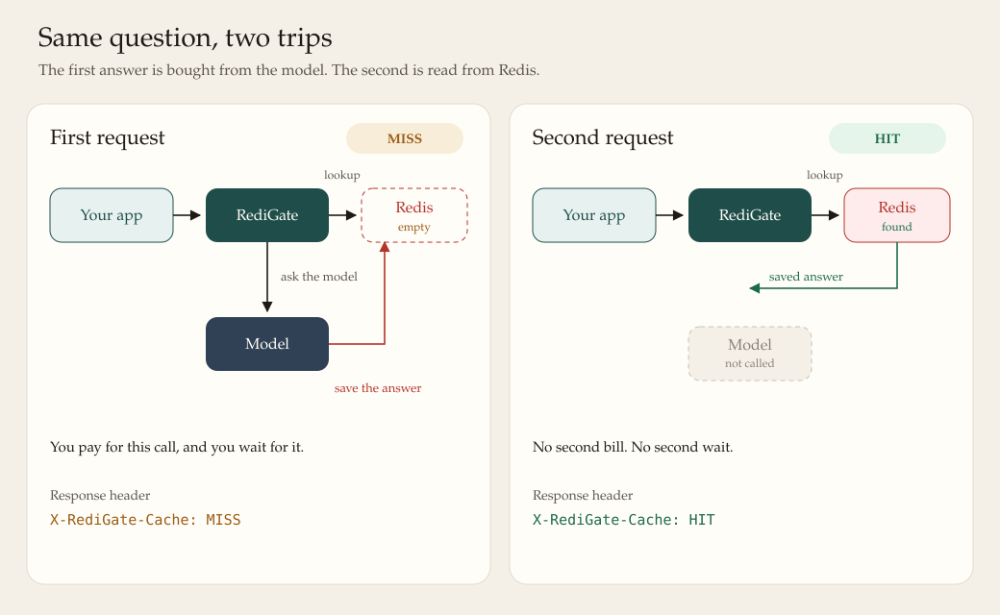
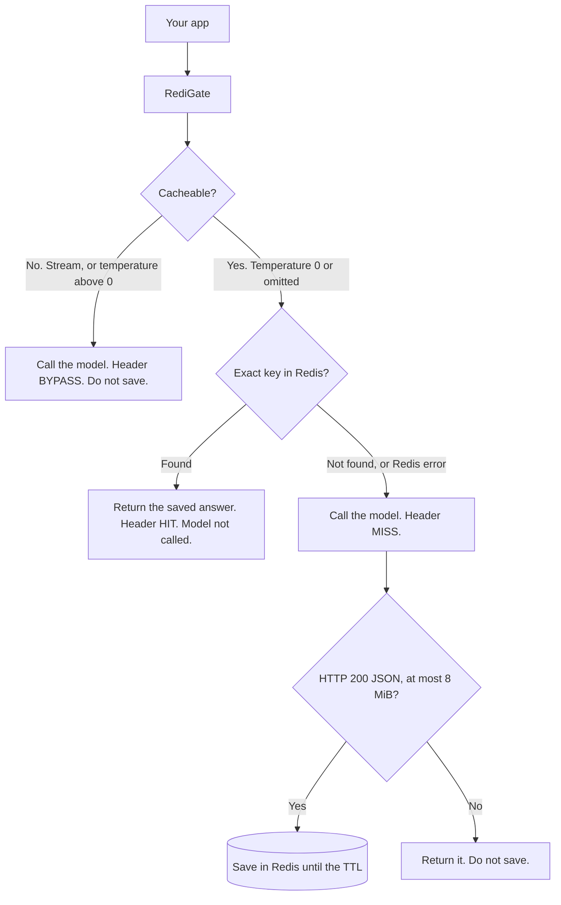
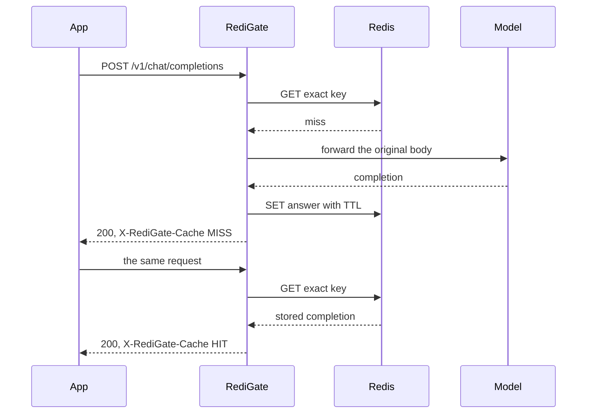

# RediGate

RediGate sits in front of a language model. Your app talks to it the same way it would talk to OpenAI. When the same question comes in again, RediGate answers from Redis instead of calling the model a second time. You skip that bill, and you skip the wait.

The match is exact. Same model, same messages, temperature at zero. A different question is a different call. A live stream, or a creative temperature, always goes to the model.

## What happens

- **First request.** Redis has nothing for this question. RediGate asks the model, saves the answer, and returns it with `X-RediGate-Cache: MISS`.
- **The same request again.** Redis has the answer. RediGate returns it with `X-RediGate-Cache: HIT`. The model is not called.
- **Not saved.** Streaming, or a temperature above zero, is forwarded and marked `X-RediGate-Cache: BYPASS`.



A short loop of the same idea is in [docs/miss-then-hit.svg](docs/miss-then-hit.svg). Browsers play it. Some README viewers show only the first frame, which is the miss.

## Quick start

You need Docker, and an OpenAI-compatible provider (OpenAI itself, or something local such as Ollama).

```bash
cp .env.example .env
# Edit .env. Set UPSTREAM_BASE_URL and, if the provider requires it, UPSTREAM_API_KEY.

docker compose up --build -d

curl -sS -D - http://127.0.0.1:8080/v1/chat/completions \
  -H 'content-type: application/json' \
  -d '{"model":"gpt-4o-mini","messages":[{"role":"user","content":"Say hi in three words."}]}'

curl -sS -D - http://127.0.0.1:8080/v1/chat/completions \
  -H 'content-type: application/json' \
  -d '{"model":"gpt-4o-mini","messages":[{"role":"user","content":"Say hi in three words."}]}'
```

The first response header is `X-RediGate-Cache: MISS`. The second is `X-RediGate-Cache: HIT`, with the same JSON body.

```bash
curl -sS http://127.0.0.1:8080/healthz
curl -sS http://127.0.0.1:8080/readyz
docker compose logs -f redigate
docker compose down
```

`/healthz` means the process is up. `/readyz` means Redis answered a ping. Compose publishes `127.0.0.1:8080` and `127.0.0.1:6379` only. Inside the app container, Redis is `redis://redis:6379/0`, not localhost. From a container, a model on your machine is usually `http://host.docker.internal:11434` rather than `127.0.0.1`.

Leave `UPSTREAM_API_KEY` empty for a local server that does not check a bearer token. `UPSTREAM_BASE_URL` may be `https://api.openai.com` or a URL that already ends in `/v1`.

## How a request moves



Temperature omitted counts as zero for that decision. The body sent to the model is still the original JSON.

## Same question, twice



The plain-language version, including what is not cached and what happens when Redis errors, is [docs/why-redis.md](docs/why-redis.md).

## Run it with Go

Go 1.22 or newer. This starts Redis only, then runs RediGate on the host. The default `REDIS_URL` is `redis://127.0.0.1:6379/0`, which matches the published port.

```bash
docker compose up -d redis
export UPSTREAM_BASE_URL=https://api.openai.com
export UPSTREAM_API_KEY=sk-...
make run
```

`make redis` is the same Redis-only command. `make test` runs the unit tests. They use an in-memory Redis and do not need Docker.

## Configuration

| Variable | Default | Purpose |
| --- | --- | --- |
| `REDIS_URL` | `redis://127.0.0.1:6379/0` | Redis URL (`redis://`, `rediss://`, or a Unix socket). Compose sets `redis://redis:6379/0` for the app service. |
| `UPSTREAM_BASE_URL` | required | Absolute `http` or `https` origin, with or without a trailing `/v1`. No username or password in the URL. |
| `UPSTREAM_API_KEY` | empty | Bearer token for the provider. Empty means no `Authorization` header. |
| `LISTEN_ADDR` | `:8080` | Listen address. Compose sets `:8080` inside the container. |
| `CACHE_TTL_SECONDS` | `3600` | Positive number of seconds to keep a saved answer. |

These are built in, not environment variables. The provider client waits up to 5 minutes for response headers, does not follow redirects, and does not compress the body, so streams pass through. Request bodies are limited to 2 MiB. Successful bodies larger than 8 MiB are returned and not stored. RediGate will not start if the first Redis ping fails. Later Redis errors do not fail the chat request.

## Cache rules, short version

A request is cached when `stream` is absent or false and `temperature` is absent or `0`. The key is a SHA-256 of the trimmed model, normalized messages, and every other JSON field except `temperature` and `stream`. Only a non-empty HTTP 200 JSON body is stored. Role case and surrounding whitespace in message text share one entry; the first reply is the one later callers receive until the TTL ends.

There is no API key for callers, no semantic cache, and no joining of identical in-flight misses. Details and a full header table are in [docs/why-redis.md](docs/why-redis.md).

## Running it safely

RediGate does not authenticate callers. Anyone who can open the port can spend your provider key. Keep it on a private network.

The sample Redis has no password. It stores full model replies until the TTL. Do not expose port 6379. Do not commit `.env`.

## Layout

| Path | Role |
| --- | --- |
| `cmd/redigate` | Process entry, Redis, shutdown |
| `internal/config` | Environment |
| `internal/cache` | Cache key and Redis get/set |
| `internal/upstream` | OpenAI-compatible HTTP client |
| `internal/gateway` | `/v1/chat/completions`, `/healthz`, `/readyz` |
| `docs/why-redis.md` | Why the cache exists, and the exact rules |
| `docs/cache-miss-hit.svg` | Miss versus hit, as a picture |
| `docs/miss-then-hit.svg` | The same story, animated |

## License

[MIT](LICENSE). Copyright (c) 2026 Sumit Bopche.
